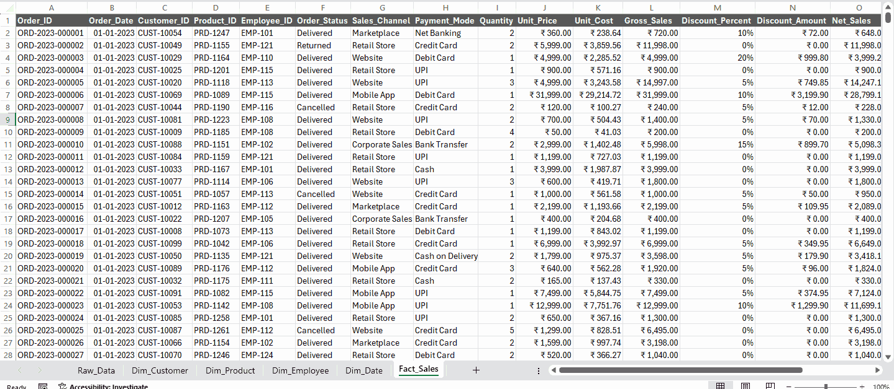
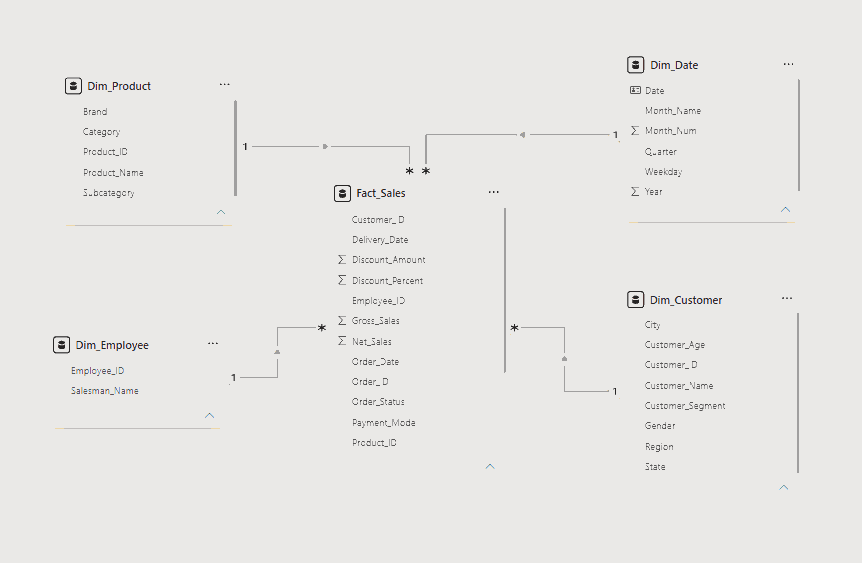
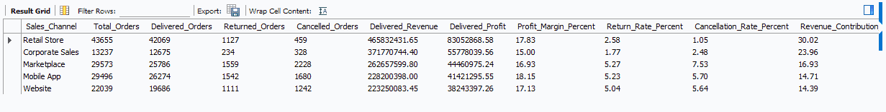

# Indian Retail Sales & Profitability Intelligence

**Tools:** Microsoft Excel, MySQL, Power BI and DAX  
**Status:** Excel and SQL completed. Power BI in progress.

An Indian retail analytics portfolio project covering orders placed from January 2023 to December 2025. The work includes Excel data preparation, a fact and dimension model, MySQL validation, and six completed SQL business questions. Power BI reporting is the next stage.

## Business objective

Analyze product profitability, customer buying patterns, monthly growth, discount performance, sales employees, and sales channels. Delivered orders are reported separately from returns and cancellations so that source sales amounts are not mistaken for completed revenue.

## Dataset and verified KPIs

| Metric | Value |
|:--|--:|
| Original records | 139,090 |
| Exact duplicates removed | 1,090 |
| Cleaned, unique orders | **138,000** |
| Delivered orders | **126,490** |
| Returned orders | 5,573 |
| Cancelled orders | 5,937 |
| Customers | 39,884 |
| Products | 268 |
| Sales employees | 24 |
| Sales channels | 5 |

| Delivered order KPI | Result |
|:--|--:|
| **Revenue** | **₹1,551,711,257.30** |
| **Estimated product profit** | **₹262,956,576.19** |
| **Estimated product profit margin** | **16.95%** |

These figures include only orders marked `Delivered`. The source records positive `Net_Sales` even on Returned and Cancelled orders. Profit is an estimated product measure, not audited company net profit.

## Excel data preparation

The original 33 fields were retained in `Raw_Data` after removing 1,090 exact duplicates. I prepared `Fact_Sales` with 138,000 unique orders and four supporting dimensions using Excel formulas including `UNIQUE`, `INDEX` with `MATCH`, `XLOOKUP`, and date functions.

All 138,000 exported fact records were checked against the source across 18 fields, with no mismatches after format normalization. Customer, product and employee references were validated. All 5,937 cancelled orders have blank delivery dates.

**Detailed methods and evidence:** [Excel Data Preparation](Excel/Data_Preparation.md)

**Fact Sales workbook view**

## Data model

| Table | Rows | Purpose |
|:--|--:|:--|
| `Fact_Sales` | 138,000 | Order amounts, status and dimension keys |
| `Dim_Customer` | 39,884 | Customer details and segments |
| `Dim_Product` | 268 | Products, categories and brands |
| `Dim_Employee` | 24 | Sales employee details |
| `Dim_Date` | 1,111 | Calendar dates and reporting attributes |

The model is designed around the order level fact table. Power BI relationship settings will be finalized during dashboard development.

**Field definitions and validation rules:** [Data Dictionary](Dataset/Data_Dictionary.md)

**Current Power BI data model**

## SQL business questions

Five prepared tables were imported into MySQL. The queries use joins, CTEs, conditional aggregation, and window functions including `LAG()` and `DENSE_RANK()`.

| Question | Analysis | Query |
|:--|:--|:--|
| BQ 01 | Most profitable products | [Product Profitability](SQL/BQ_01_Product_Profitability.sql) |
| BQ 02 | High value and repeat customers | [Customer Analysis](SQL/BQ_02_Customer_Analysis.sql) |
| BQ 03 | Monthly revenue and growth | [Monthly Sales Growth](SQL/BQ_03_Monthly_Sales_Growth.sql) |
| BQ 04 | Discount bands and profitability | [Discount Analysis](SQL/BQ_04_Discount_Analysis.sql) |
| BQ 05 | Employee revenue and profit rankings | [Employee Performance](SQL/BQ_05_Employee_Performance.sql) |
| BQ 06 | Channel sales, returns and cancellations | [Channel Performance](SQL/BQ_06_Channel_Performance.sql) |

**Exactly six business questions** were completed. The separate SQL reconciliation query was used only for validation.

Revenue comparisons use delivered orders. The channel analysis also examines returns and cancellations separately, so its status rates remain distinct from financial KPIs.

### Findings from SQL

| Area | Result |
|:--|:--|
| Products | Wakefit Wooden Bed with Storage ranked first in estimated profit at **₹61.83 lakh**. |
| Customers | The top 20 customers by delivered revenue were Corporate repeat customers. |
| Growth | October 2025 revenue was **₹7.37 crore**, with **71.77%** growth over September. |
| Discounts | Estimated margin was **21.19%** without discount versus **11.67%** in the 6% to 10% discount band. |
| Employees | The top salesperson by revenue generated approximately **₹8.27 crore**. |
| Channels | Retail Store contributed **30.02%** of delivered revenue. Marketplace had a **7.53%** cancellation rate. |

These are descriptive findings. Discount margin differences do not prove causation, and status based cancellation rates do not measure the full order lifecycle.

**Sales channel analysis result**

[View all Excel, SQL, and model screenshots](Screenshots/README.md). Customer and employee names are hidden in public screenshots where relevant.

## Power BI and project status

Power BI work is in progress. The remaining tasks are to verify relationships, create DAX measures, complete six Power BI reporting questions, and publish interactive dashboards.

| Completed | In progress or pending |
|:--|:--|
| Excel cleaning and source validation | Power BI relationships and DAX |
| Fact and dimension preparation | Interactive dashboards |
| Six SQL business questions | Final business recommendations |
| Excel documentation and data dictionary | Dashboard screenshots and report |

The repository contains [Excel documentation](Excel/), the [Data Dictionary](Dataset/), [six SQL files](SQL/), and a [screenshot gallery](Screenshots/README.md). SQL scripts require MySQL 8 or later and the corresponding tables to be imported before execution.

## Data availability

The full workbook and individual customer records are not publicly included because they contain names and location information. Sharing the source files would require a privacy and usage rights review.

This is a portfolio project. Results describe the supplied dataset and do not establish independently verified commercial impact.

**GitHub:** [forevershivam](https://github.com/forevershivam)
