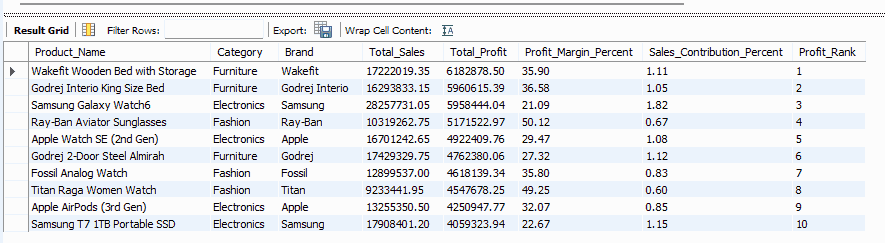
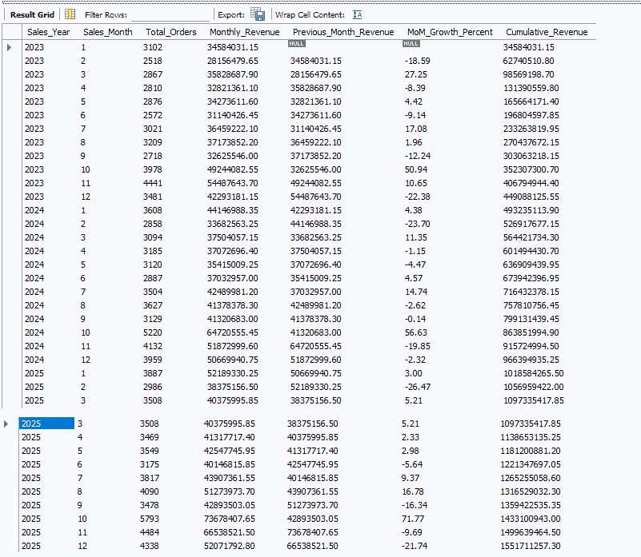

# Indian Retail Sales & Profitability Intelligence

**Microsoft Excel | MySQL | Power BI | DAX**

**Project status:** Excel preparation and SQL analysis complete. Power BI reporting in progress.

## Project Overview

I started this project with a generated retail practice dataset containing 139,090 transaction records from January 2023 through December 2025. The aim was to turn the raw data into something useful for business analysis: a trustworthy sales dataset, a structured analytical model, and clear answers to questions about profitability, customers, growth, and sales channels.

Rather than moving straight to visualizations, I began by preparing the data in Excel. I then used MySQL to validate the figures and investigate six business questions. The next stage is to build interactive Power BI reports using the prepared model.

## From Raw Data to Reliable Sales Figures

The first step was to remove **1,090 exact duplicate records**, leaving **138,000 unique orders**. I retained the original 33 fields in the cleaned `Raw_Data` sheet, then prepared an order level `Fact_Sales` table and four dimension tables using `UNIQUE`, `INDEX` with `MATCH`, `XLOOKUP`, and Excel date functions.

I compared all 138,000 exported fact records against the original source across 18 matching fields. After accounting for different date, currency, and percentage formats, the values matched. Customer, product, and employee keys were also checked, while the **5,937 cancelled orders** retained blank delivery dates.

**See the work:** [Excel Data Preparation](Excel/Data_Preparation.md) and [Data Dictionary](Dataset/Data_Dictionary.md).

### Analytical Model

The prepared model contains one fact table and four dimensions.

| Table | Records | Purpose |
|:--|--:|:--|
| `Fact_Sales` | 138,000 | Order quantities, sales, profit, status, and keys |
| `Dim_Customer` | 39,884 | Customer and segment details |
| `Dim_Product` | 268 | Product, category, and brand details |
| `Dim_Employee` | 24 | Sales employee details |
| `Dim_Date` | 1,111 | Calendar attributes for reporting |

The model structure is already prepared. Final relationships and reporting measures will be reviewed in Power BI.

## Defining Revenue Correctly

A key issue surfaced during validation: **Returned and Cancelled orders also have positive `Net_Sales` values in the source**. Adding every order together would therefore give a misleading picture of delivered sales.

For the financial analysis, I used only orders marked **Delivered**. Returns and cancellations are examined separately where relevant.

| Verified measure | Value |
|:--|--:|
| Cleaned orders | **138,000** |
| Delivered orders | **126,490** |
| Returned orders | 5,573 |
| Cancelled orders | 5,937 |
| Delivered revenue | **₹1,551,711,257.30** |
| Estimated product profit | **₹262,956,576.19** |
| Estimated product profit margin | **16.95%** |

The profit field represents *estimated product profit*, not audited net profit after all business expenses.

## What the SQL Analysis Revealed

With the prepared tables imported into MySQL, I used joins, CTEs, conditional aggregation, `LAG()`, and `DENSE_RANK()` to explore six business questions. Three examples show the range of analysis.

### BQ 01: Product Profitability

**Business question:** Which products generate the highest estimated profit, and how much do they contribute to total delivered sales?

**SQL query:** [Product Profitability](SQL/BQ_01_Product_Profitability.sql)

**Finding:** Wakefit Wooden Bed with Storage ranked first, generating approximately **₹61.83 lakh** in estimated product profit. This helps identify high contribution products worth examining in inventory and product mix decisions.

### BQ 03: Monthly Sales Growth

**Business question:** How does delivered revenue change month by month, and what do the month over month growth rates show?

**SQL query:** [Monthly Sales Growth](SQL/BQ_03_Monthly_Sales_Growth.sql)

**Finding:** October 2025 delivered revenue was approximately **₹7.37 crore**, with **71.77% growth** over September. October was also strong in the prior two years, suggesting a possible seasonal pattern to investigate. The dataset alone does not establish what caused the increase.

### BQ 06: Sales Channel Performance

**Business question:** Which channels produce the highest delivered revenue and estimated profit, and how do returns and cancellations compare?

**SQL query:** [Sales Channel Performance](SQL/BQ_06_Channel_Performance.sql)

**Finding:** Retail Store contributed **30.02%** of delivered revenue, while Marketplace showed a **7.53% cancellation rate**. A useful next business step would be to investigate cancellation reasons in Marketplace orders before deciding on changes.

### All Six SQL Business Questions

| ID | Focus | SQL file |
|:--|:--|:--|
| BQ 01 | Product profitability | [View query](SQL/BQ_01_Product_Profitability.sql) |
| BQ 02 | High value and repeat customers | [View query](SQL/BQ_02_Customer_Analysis.sql) |
| BQ 03 | Monthly sales growth | [View query](SQL/BQ_03_Monthly_Sales_Growth.sql) |
| BQ 04 | Discount impact on profitability | [View query](SQL/BQ_04_Discount_Analysis.sql) |
| BQ 05 | Employee sales and profit rankings | [View query](SQL/BQ_05_Employee_Performance.sql) |
| BQ 06 | Channel performance | [View query](SQL/BQ_06_Channel_Performance.sql) |

Other useful findings include Corporate repeat customers among the top 20 buyers, and an estimated profit margin of **21.19%** for orders without discounts compared with **11.67%** for the 6% to 10% discount group. This is an observed difference between groups, not proof that discounts alone caused the margin change.

The project contains **six SQL business questions**. A separate reconciliation query was used for verification only and is not counted as a business question.

[Explore all execution screenshots and Excel evidence](Screenshots/README.md).

## Next Stage: Power BI

The SQL analysis provides a foundation for the reporting stage. I will verify the existing model relationships, create DAX measures, complete six Power BI business questions, and build interactive dashboards for sales and profitability analysis.

| Completed | In progress |
|:--|:--|
| Excel cleaning and fact/dimension preparation | Power BI model verification |
| Data validation and reconciliation | DAX measures and interactive dashboards |
| Six MySQL business analyses | Final business recommendations |
| Excel documentation and data dictionary | Dashboard screenshots and report |

The report and final dashboard screenshots will be published once they are completed and reviewed.

## Data and Reproducibility

This project uses a **synthetic practice dataset generated for portfolio learning**. The repository shares the documented transformation process, schema, six SQL queries, and their execution screenshots. The complete source workbook and row level data are not included; the original generated dataset's public redistribution rights have not been independently established. To execute the SQL files, load the corresponding prepared fact and dimension tables into MySQL 8 or later.

**Repository:** [Indian Retail Sales & Profitability Intelligence](https://github.com/forevershivam/indian-retail-sales-profitability-intelligence)
