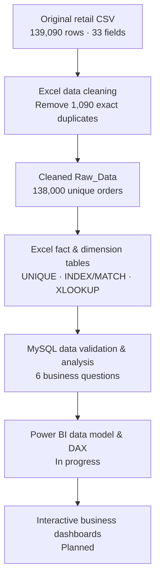

# Indian Retail Sales & Profitability Intelligence

### Excel Data Preparation • MySQL Business Analysis • Power BI & DAX

**An end-to-end retail analytics portfolio project** focused on transforming raw transactional data into a reliable analytical model, answering business questions with SQL, and developing decision-ready reporting in Power BI.


> **Project status:** Excel preparation and six SQL business-question analyses are complete. Power BI measures, interactive dashboards, and final consolidated recommendations are under development. This repository is being published in stages; it does **not** present an unfinished dashboard as a completed deliverable.

**Explore:** [Data Preparation](Excel/Data_Preparation.md) · [Data Dictionary](Dataset/Data_Dictionary.md) · [SQL Analyses](SQL/)

---

## 01 · Business Context

Retail performance cannot be assessed by sales totals alone. A useful business view must distinguish delivered orders from returns and cancellations, identify profitable products and customer behavior, measure growth, and highlight channel-level operational issues.

This project explores:

- **Profitability:** Which products contribute the most estimated profit?
- **Customers:** Which customers drive delivered revenue, and how often do they purchase?
- **Growth:** How does monthly delivered revenue evolve over time?
- **Discounting:** How do profit margins differ across discount bands?
- **Employees:** How do salesperson revenue and profit rankings compare?
- **Channels:** Which channels drive revenue, returns, and cancellations?

The goal is evidence-based analysis, not simply producing charts.

## 02 · Dataset at a Glance

| Measure | Audited result |
|:--|--:|
| Original transactional rows | **139,090** |
| Exact duplicate rows removed | **1,090** |
| Cleaned, unique orders | **138,000** |
| Original fields retained in cleaned source | **33** |
| Delivered orders | **126,490** |
| Returned orders | **5,573** |
| Cancelled orders | **5,937** |
| Unique customers in customer dimension | **39,884** |
| Products | **268** |
| Sales employees | **24** |
| Sales channels | **5** |
| Order-date coverage | **Jan 2023 – Dec 2025** |

### Verified delivered-sales KPIs

| KPI | Result |
|:--|--:|
| **Delivered Revenue** | **₹1,551,711,257.30** (₹155.17 crore) |
| **Estimated Product Profit** | **₹262,956,576.19** (₹26.30 crore) |
| **Estimated Product Profit Margin** | **16.95%** |
| **Customers with ≥1 delivered order** | **39,043** |

**Definition matters:** Only `Order_Status = 'Delivered'` contributes to the delivered-revenue and delivered-profit KPIs above. Source `Net_Sales` remains positive on Returned and Cancelled records, so treating every status as completed revenue would be misleading. `Profit` is a **source-recorded estimated product profit**, not audited net accounting profit.

## 03 · Project Workflow



### Excel: preparation and quality checks — complete

- Deduplicated the raw order records while retaining all unique `Order_ID` values.
- Organized a **138,000-row `Fact_Sales`** table with four reusable dimensions: **Customer, Product, Employee, and Date**.
- Used Excel dynamic arrays, lookup formulas, and date functions for structured data preparation.
- Verified the exported fact records against the original source and checked dimension keys.
- Kept cancellation delivery dates blank instead of inventing values.

**Read the full audit-backed workflow:** [Excel/Data_Preparation.md](Excel/Data_Preparation.md)

### MySQL: analytical SQL — complete

Loaded and validated the prepared fact/dimension tables, then answered **exactly six business questions** using CTEs, joins, aggregation, `CASE` expressions, and analytical window functions such as `LAG()` and `DENSE_RANK()`.

| ID | Business question | SQL |
|:--|:--|:--|
| **BQ-01** | Which products deliver the highest estimated profit and sales contribution? | [Product profitability](SQL/BQ_01_Product_Profitability.sql) |
| **BQ-02** | Who are the highest-value customers, and which are repeat customers? | [Customer analysis](SQL/BQ_02_Customer_Analysis.sql) |
| **BQ-03** | How are monthly revenue and month-over-month growth changing? | [Monthly sales growth](SQL/BQ_03_Monthly_Sales_Growth.sql) |
| **BQ-04** | How do revenue and estimated profit margins vary by discount band? | [Discount analysis](SQL/BQ_04_Discount_Analysis.sql) |
| **BQ-05** | Which employees lead on delivered revenue and estimated profit? | [Employee performance](SQL/BQ_05_Employee_Performance.sql) |
| **BQ-06** | How do channels compare on revenue, returns, and cancellations? | [Channel performance](SQL/BQ_06_Channel_Performance.sql) |

**Counting convention:** The final data-reconciliation check is a *validation query*, **not** a seventh business question.

### Power BI: dashboards and DAX — in progress

The Power BI stage will build on the prepared tables and validated KPI definitions. Planned deliverables include dynamic measures, interactive visualizations, and six separate Power BI business analyses. Screenshots and report files will be published **after** they are verified and finalized.

## 04 · Data Model

The analytical design uses a central order-level fact table and four supporting dimensions.

```text
                   Dim_Customer
                        |
Dim_Product  ——  Fact_Sales  ——  Dim_Employee
                        |
                     Dim_Date
```

| Table | Rows | Columns | Purpose |
|:--|--:|--:|:--|
| `Fact_Sales` | 138,000 | 18 | Order-level quantities, prices, costs, discounts, net sales, status and profit |
| `Dim_Customer` | 39,884 | 8 | Customer identifiers, segments and geography |
| `Dim_Product` | 268 | 5 | Product, category, subcategory and brand |
| `Dim_Employee` | 24 | 2 | Sales employee lookup |
| `Dim_Date` | 1,111 | 6 | Calendar attributes from 2023-01-01 to 2026-01-15 |

**Primary modeling intent:** Many fact records relate to one customer, product, employee and order date. Final Power BI relationship settings will be checked in the reporting stage.

**Full field definitions, source-to-table mapping, and metric rules:** [Dataset/Data_Dictionary.md](Dataset/Data_Dictionary.md)

## 05 · Selected SQL Findings

These observations come from the executed SQL query outputs; they are **descriptive findings**, not claims of causal impact.

| Area | Finding | Business interpretation |
|:--|:--|:--|
| Product | **Wakefit Wooden Bed with Storage** ranked #1 on estimated profit (**₹61.83 lakh**). | High-contribution products merit product-mix and inventory review. |
| Customer | The **top 20 revenue-ranked customers** in the query output were repeat customers in the Corporate segment. | High-value corporate relationships deserve closer segment-level analysis. |
| Growth | **October 2025** delivered revenue reached approximately **₹7.37 crore**, up **71.77% MoM**. | Investigate recurring October demand spikes and possible seasonality. |
| Discount | **No-discount** orders showed **21.19%** margin; the **6–10% discount band** showed **11.67%**. | Compare product and customer mix before attributing profitability differences to discounts. |
| Employees | The leading revenue-ranked salesperson generated approximately **₹8.27 crore** in delivered revenue. | Compare revenue ranks with estimated profit ranks and assigned opportunities. |
| Channels | **Retail Store** generated **30.02%** of delivered revenue; **Marketplace** had a **7.53%** cancellation rate. | Marketplace fulfillment and cancellation patterns warrant investigation. |

*Channel return/cancellation rates here use the number of orders currently recorded with each status divided by all orders in that channel; they are not lifecycle-based cohort return rates.*

## 06 · Repository Structure

```text
indian-retail-sales-profitability-intelligence/
├── README.md
├── Dataset/
│   └── Data_Dictionary.md
├── Excel/
│   └── Data_Preparation.md
└── SQL/
    ├── BQ_01_Product_Profitability.sql
    ├── BQ_02_Customer_Analysis.sql
    ├── BQ_03_Monthly_Sales_Growth.sql
    ├── BQ_04_Discount_Analysis.sql
    ├── BQ_05_Employee_Performance.sql
    └── BQ_06_Channel_Performance.sql
```

More files will be added only after their respective project stages are completed and reviewed.

## 07 · Tools & Skills Demonstrated

| Tool | Work demonstrated |
|:--|:--|
| **Microsoft Excel** | Data deduplication, source reconciliation, dynamic arrays, lookup formulas, fact/dimension preparation, calendar creation |
| **MySQL** | Table imports, data validation, joins, CTEs, conditional aggregation, window functions, ranking and trend analysis |
| **Power BI / DAX** | **In progress:** data-model verification, measures, report interactivity and dashboard development |

### Reproducing the SQL analysis

The six `.sql` files are written for MySQL 8+ features including CTEs and window functions. They run **after** the `fact_sales` and related `dim_*` tables have been prepared and imported using the documented data model. The repository currently provides analytical queries and schema documentation—not a complete public database dump or a one-click setup script.

## 08 · Data Availability & Scope

The source workbook and row-level CSV exports are **not publicly included at this stage**. The source contains names and location fields; any future publication of row-level data requires a deliberate privacy, provenance and sharing-rights review. Available documentation records the actual cleaning rules, schema, and validation results without exposing those fields.

This is a **portfolio analysis project**, not a claim of verified commercial impact, a deployed production system, or audited company financial reporting.

## 09 · Next Milestones

- [x] Excel data cleaning, deduplication and dimensional preparation
- [x] Source-to-output and financial reconciliation
- [x] Six SQL business-question analyses
- [x] Excel preparation documentation and data dictionary
- [ ] Finalize Power BI relationships and dynamic DAX KPIs
- [ ] Complete six Power BI business analyses and dashboard pages
- [ ] Publish dashboard screenshots and finalized reporting artifacts
- [ ] Consolidate cross-tool business recommendations

---

**Portfolio project by [Shivam](https://github.com/forevershivam)** · Documentation and results reflect the current verified project stage.
